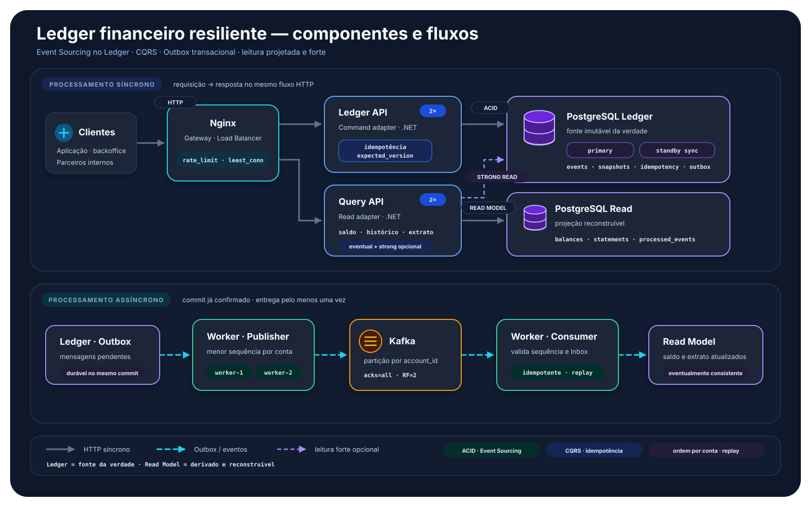
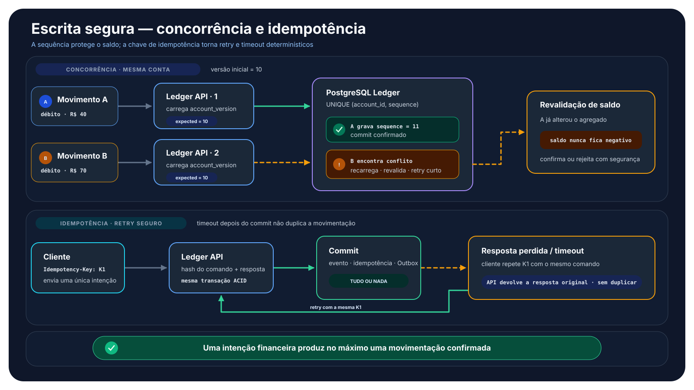
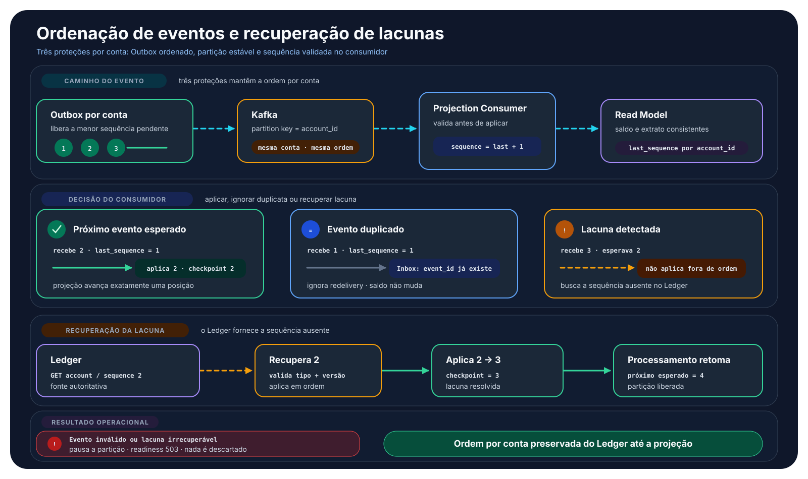
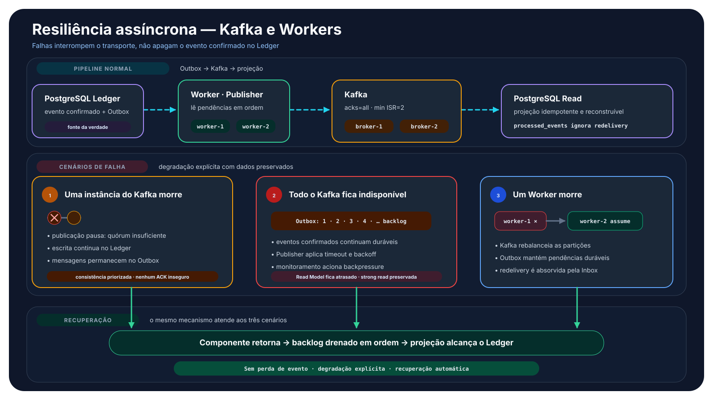
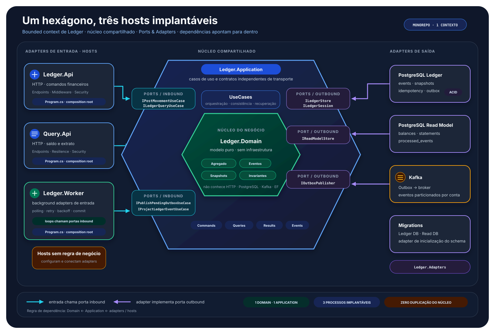
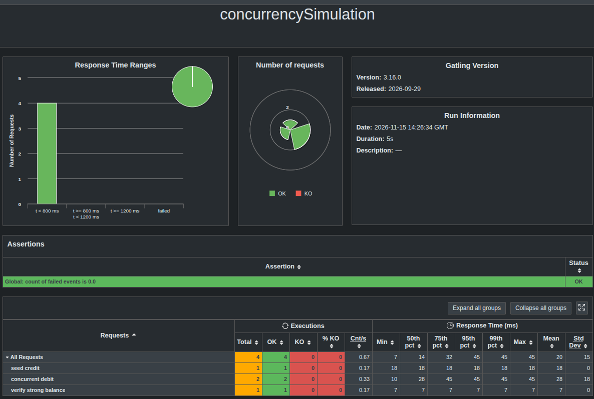
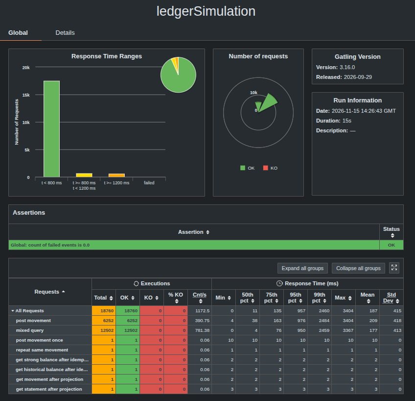
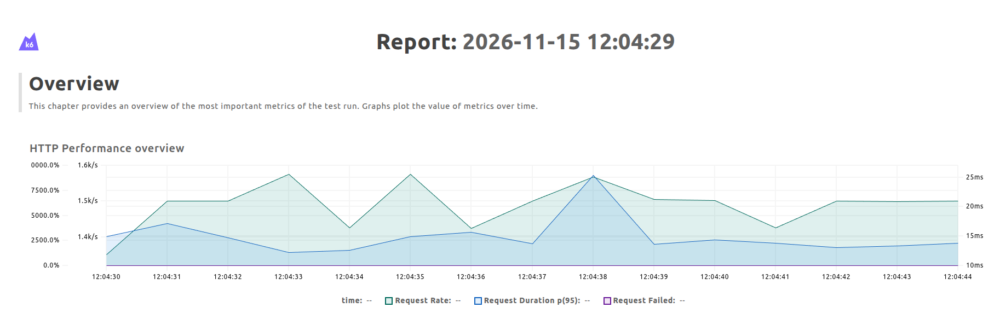

# Ledger financeiro resiliente

Implementação em **C#/.NET 10** de um Ledger de créditos e débitos com Event Sourcing, CQRS, Transactional Outbox, Kafka e Read Model independente.

## O que está implementado

- três aplicações independentes: Ledger API, Query API e Ledger Worker;
- PostgreSQL Ledger como fonte da verdade e outro PostgreSQL para leitura;
- concorrência otimista por conta, idempotência persistida e saldo nunca negativo;
- saldo atual eventual/forte, saldo histórico por `recorded_at` e extrato paginado;
- Outbox ordenado por conta, Kafka e projeção idempotente;
- snapshots transacionais a cada 50 eventos;
- JWT, scopes e autorização por conta;
- duas réplicas de cada aplicação, três nós Kafka broker/controller e Nginx;
- PostgreSQL Ledger primário/standby com WAL síncrono para demonstração local;
- OpenAPI/Scalar, AsyncAPI, xUnit/Testcontainers, Gatling e k6.






## Estrutura hexagonal

- `Ledger.Domain`: agregado, eventos, snapshots e invariantes, sem dependências de infraestrutura;
- `Ledger.Application`: casos de uso e contratos separados em `UseCases`, `Commands`, `Queries`, `Results`, `Ports/Inbound` e `Ports/Outbound`;
- `Ledger.Adapters`: implementações de saída organizadas por PostgreSQL Ledger, Read Model, migrations e Kafka;
- `Ledger.Api` e `Query.Api`: adapters HTTP separados em endpoints, middleware, segurança e configuração;
- `Ledger.Worker`: adapters de entrada em background; os loops chamam portas inbound para publicar o Outbox e projetar eventos, sem orquestração de negócio no host;
- cada `Program.cs` é apenas o composition root do processo, sem regras de negócio ou implementação dos workers.

Os detalhes e a direção das dependências estão no [ADR-006](docs/adrs/ADR-006-arquitetura-hexagonal-e-solid.md).

O repositório é um monorepo com um único hexágono do bounded context de Ledger e três hosts implantáveis. As APIs e o Worker não duplicam domínio e aplicação: cada host fornece seus adapters de entrada e seu composition root sobre o núcleo compartilhado.



## Documentação

- [Arquitetura](docs/system-design/architecture.md)
- [Componentes arquiteturais](docs/system-design/architectural-components.md)
- [Endpoints](docs/system-design/endpoints.md)
- [Autenticação e autorização](docs/system-design/authentication-authorization.md)
- [Escalabilidade e infraestrutura](docs/system-design/scalability-infrastructure.md)
- [Modelo de dados](docs/system-design/data-model.md)
- [Ledger Worker](docs/system-design/worker.md)
- [FAQ de falhas, concorrência e idempotência](docs/system-design/faq.md)
- [ADR-013 — Kafka com três nós e tolerância à falha](docs/adrs/ADR-013-kafka-tres-nos-alta-disponibilidade.md)

## Pré-requisitos

- Docker Engine com Docker Compose v2;
- aproximadamente 10 GB de memória disponíveis para o ambiente completo;
- Node.js 22+ para gerar tokens e executar o smoke test;
- .NET SDK 10 apenas para build/testes fora dos containers;
- k6 opcional para testes de stress.

## Execução local

```bash
cp .env.example .env
docker compose up --build -d
docker compose ps
```

Ao reconstruir as APIs com o ambiente já em execução, use `docker compose restart edge` após o build para renovar imediatamente os IPs atribuídos pelo DNS interno do Docker.

O primeiro build baixa imagens e pacotes. Aguarde até `edge`, APIs, Workers, bancos e brokers ficarem saudáveis. O único endpoint HTTP publicado é:

```text
http://localhost:8080
```

No ambiente local, cada API publica seu próprio contrato e interface:

#### Ledger
- OpenAPI: http://localhost:8080/docs/ledger/openapi/v1.json
- Scalar: http://localhost:8080/docs/ledger/scalar/v1
####  Query
- OpenAPI: http://localhost:8080/docs/query/openapi/v1.json
- Scalar: http://localhost:8080/docs/query/scalar/v1

## Token local

As APIs não emitem tokens. Para o ambiente didático, gere um JWT curto:

```bash
ACCOUNT_ID=11111111-1111-1111-1111-111111111111
TOKEN=$(node scripts/dev/generate-token.mjs "$ACCOUNT_ID")
```

É possível limitar os scopes:

```bash
TOKEN=$(node scripts/dev/generate-token.mjs "$ACCOUNT_ID" "ledger.balance.read,ledger.statement.read")
```

## Smoke test

```bash
node scripts/validation/smoke.mjs
```

O script confirma escrita, idempotência, convergência do saldo eventual com o forte e extrato.

## Build e testes

```bash
dotnet restore Ledger.slnx
dotnet format Ledger.slnx --verify-no-changes --no-restore
dotnet build Ledger.slnx -c Release --no-restore
dotnet test Ledger.slnx -c Release --no-build
```

Os testes de integração usam Testcontainers e precisam de acesso ao Docker.

## Testes de carga




As metas arquiteturais são **5.000 req/s na Ledger API** e **10.000 req/s na Query API**. Os cenários locais exercitam 10% dessas metas por padrão: **500 req/s na Ledger API** e **1.000 req/s na Query API**. Os resultados dependem do hardware; a capacidade final deve ser medida no ambiente alvo.

Os runners abaixo executam todas as simulações encontradas. Por padrão, a carga é distribuída entre 500 contas para medir a capacidade agregada sem transformar uma única conta em um hot spot. O runner k6 usa uma faixa de contas diferente por perfil e aplica cooldown entre arquivos, impedindo que backlog e histórico de um cenário contaminem o seguinte.

Todos os cenários Gatling TypeScript:

```bash
sh scripts/performance/run-all-gatling.sh
```


Todos os cenários k6:

```bash
sh scripts/performance/run-all-k6.sh
```

Cada execução gera dashboards HTML e resumos JSON em `reports/k6/<data-hora>/`. O período de agregação dos gráficos é de 1 segundo para que os cenários curtos também produzam séries visíveis. Para salvar adicionalmente todos os pontos das séries temporais em JSON, use:

```bash
K6_EXPORT_RAW=true sh scripts/performance/run-all-k6.sh
```

Os resultados brutos podem ocupar bastante espaço em cargas elevadas.



## Falhas e recuperação

Os scripts abaixo interrompem componentes do ambiente local:

```bash
sh scripts/failure/kafka-outage.sh
sh scripts/failure/kafka-broker-failover.sh
sh scripts/failure/read-outage.sh
sh scripts/failure/worker-outage.sh
sh scripts/failure/api-replica-outage.sh
sh scripts/failure/ledger-failover.sh
sh scripts/failure/replay-read-model.sh
```

Comportamento esperado:

- um broker Kafka parado: o cluster mantém quórum, publicação e projeção com duas réplicas sincronizadas;
- todo o Kafka parado: escritas continuam e o Outbox acumula;
- Read DB parado: saldo usa fallback forte; extrato e movimentação retornam `503`;
- Workers parados: eventos permanecem no Outbox;
- primário parado: promoção controlada do standby e reconexão multi-host;
- Read Model perdido: reprojeção completa a partir do Ledger.

O Compose demonstra mecanismos de redundância no mesmo host; ele não representa Multi-AZ real.

Detalhes em:
- [Escalabilidade e infraestrutura](docs/system-design/scalability-infrastructure.md)
- [FAQ de falhas, concorrência e idempotência](docs/system-design/faq.md)

## Encerramento

```bash
docker compose down
```

Para também apagar os dados locais:

```bash
docker compose down --volumes
```

## Limitações deliberadas

- Escopo minímo para atender o desafio, permitindo evolução futura
- Somente BRL;
- Sem transferências e sem partidas dobradas (soma zero);
- Sem endpoint de estorno;
- Read Model com uma instância;
- os três nós Kafka locais compartilham o mesmo host; a tolerância a falha demonstrada não substitui distribuição Multi-AZ;
- Nginx representa didaticamente a borda; cloud usaria WAF, API Gateway e Load Balancer gerenciados.
