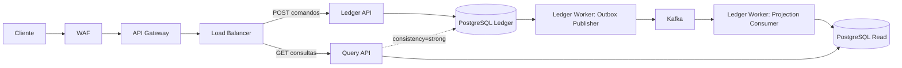

# Architectural components and responsibilities

## Visão geral

A solução possui três aplicações C# implantáveis e dois bancos PostgreSQL independentes. Somente o Ledger é fonte da verdade; o Read Model pode ser apagado e reconstruído pelo replay dos eventos.

A separação segue o padrão **CQRS**:

- comandos de crédito e débito usam o PostgreSQL Ledger;
- consultas de saldo e extrato usam o PostgreSQL Read;
- cada banco pode ser dimensionado separadamente, pois a carga de leitura tende a ser maior que a carga de escrita;
- aumentar a capacidade do banco de leitura não interfere na consistência do Ledger; no desafio ele terá uma única instância.

| Componente | Responsabilidades principais |
|---|---|
| WAF | Bloquear ataques conhecidos e aplicar regras de origem/IP; limitar payloads e requisições malformadas antes da aplicação |
| API Gateway | Validar token e aplicar rate limit/quotas; rotear comandos para a Ledger API e consultas para a Query API |
| Load Balancer | Distribuir tráfego entre réplicas saudáveis; retirar instâncias que falharem no readiness check |
| Ledger API | Validar crédito e débito; gravar evento, idempotência e Outbox na mesma transação ACID |
| Query API | Consultar saldo, extrato e movimentação; informar checkpoint/defasagem da projeção e oferecer leitura forte quando solicitada |
| PostgreSQL Ledger | Manter eventos imutáveis, snapshots e idempotência; garantir concorrência por `account_id + sequence` e persistir o Outbox |
| Ledger Worker — Outbox Publisher | Buscar mensagens pendentes após o commit; publicar no Kafka pelo menos uma vez e marcar a publicação |
| Kafka | Desacoplar escrita e projeção; preservar a ordem de cada conta usando `account_id` como chave de partição |
| Ledger Worker — Projection Consumer | Consumir eventos em um consumer group; atualizar saldo/extrato e registrar o evento processado na mesma transação do Read Model |
| PostgreSQL Read | Servir consultas de baixa latência; manter saldo, extrato e controle idempotente de eventos processados |

WAF, API Gateway e Load Balancer representam a borda de cloud. No Docker do desafio, o Nginx demonstra roteamento, balanceamento e rate limit conforme o ADR-002.

## Aplicações C#

```text
Ledger.sln
├── Ledger.Api          # host e adaptador HTTP de comandos
├── Query.Api           # host e adaptador HTTP de consultas
├── Ledger.Worker       # hosts dos adaptadores de background
├── Ledger.Domain       # regras e invariantes
├── Ledger.Application  # casos de uso e portas
└── Ledger.Adapters     # adaptadores PostgreSQL e Kafka
```

Essa organização segue Arquitetura Hexagonal: domínio e casos de uso não dependem dos adaptadores. ASP.NET Core, PostgreSQL e Kafka permanecem nas bordas, conforme o ADR-006.

As três aplicações são publicadas e implantadas separadamente:

- `Ledger.Api`: escala conforme o volume de créditos e débitos;
- `Query.Api`: escala conforme o volume de consultas;
- `Ledger.Worker`: executa Outbox Publisher e Projection Consumer e escala conforme o backlog.

## Fluxo de dados



## Fronteiras importantes

- A Ledger API não grava no Read Model.
- A Query API não altera o Ledger.
- O Projection Consumer não recalcula regras de negócio; apenas aplica eventos já confirmados.
- Nenhuma transação tenta confirmar alterações nos dois bancos ao mesmo tempo.
- Kafka transporta eventos, mas não é a fonte da verdade.
