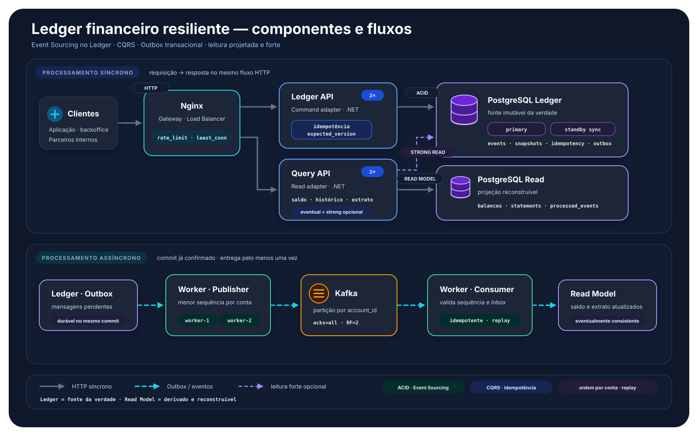

# Proposta de arquitetura - Ledger de movimentacoes financeiras

## 1. Resumo executivo

A proposta usa **Event Sourcing apenas no dominio de Ledger**, onde a trilha imutavel agrega valor real, com **CQRS** para separar escrita consistente de consultas em escala. A API e os workers sao stateless e podem ser replicados em duas ou mais zonas de disponibilidade. O PostgreSQL e a fonte da verdade; Kafka distribui eventos, mas nao substitui o ledger.

### Decisoes centrais

- A solucao aplica **CQRS**: comandos usam o PostgreSQL Ledger e consultas usam outro PostgreSQL para o Read Model. Os bancos sao separados porque leitura e escrita possuem cargas diferentes e precisam escalar de forma independente; normalmente o volume de consultas e maior.
- Cada credito ou debito vira um evento imutavel do ledger. Eventos publicados nunca sao alterados; uma futura funcionalidade de correcao devera usar eventos compensatorios.
- Cada conta e um agregado independente, com `account_id`, `sequence` e `expected_version`. Uma restricao unica em `(account_id, sequence)` implementa concorrencia otimista.
- `Idempotency-Key` tem restricao unica por operacao. Repetir a mesma requisicao devolve o mesmo resultado, sem duplicar a movimentacao.
- Valores monetarios usam somente `BIGINT` em unidade minima (`amount_minor`); no MVP, BRL em centavos. Nunca se usa `float`/`double`.
- O append do evento e a gravacao do Outbox ocorrem na mesma transacao ACID. Nao existe dual-write entre banco e broker.
- Snapshots sao uma otimizacao descartavel, nao a fonte da verdade. O saldo em `T` usa o snapshot com `last_recorded_at <= T` e reproduz os eventos posteriores com `recorded_at <= T`.
- Para volume alto, o modelo de leitura materializa saldo atual e extrato. Uma consulta que exija consistencia forte usa o ledger primario; consultas comuns usam a projecao e informam seu checkpoint.
- Para reduzir o escopo do desafio, cada movimentacao e representada diretamente em `ledger_events`, sem uma tabela de partidas dobradas. A adocao de um ledger contabil completo fica registrada como evolucao de producao no ADR correspondente.

## 2. Componentes e responsabilidades

| Componente | Responsabilidade | Decisao |
|---|---|---|
| API Gateway / WAF / Load Balancer | TLS, autenticacao, rate limit, roteamento e protecao de borda | Endpoint unico e distribuicao entre instancias saudaveis |
| Ledger API (.NET C#) | Validar comandos, autorizacao, idempotencia, invariantes e append de eventos | Stateless; minimo de duas replicas em zonas diferentes |
| Query API (.NET C#) | Consultar saldo atual/historico e extrato, expondo o checkpoint da leitura | Escala independentemente da escrita |
| PostgreSQL HA | Event Store, idempotencia, snapshots, Outbox e auditoria tecnica | Primario + standby sincrono multi-AZ; PITR e backups testados |
| Ledger Worker / Outbox Publisher | Publicar eventos confirmados no broker | Entrega pelo menos uma vez; consumidores idempotentes |
| Kafka / Redpanda | Desacoplar projecoes e integracoes | Particionar por `account_id` preserva ordem por conta |
| Ledger Worker / Projection Consumer | Atualizar saldo, extrato e controle de eventos processados | Reprocessavel desde o Event Store/broker |
| PostgreSQL Read Model | Otimizar consultas de saldo e extrato | Banco fisicamente separado do PostgreSQL Ledger e reconstruivel pelo replay |

Para o desafio, a solution .NET possui tres aplicacoes implantaveis separadamente: `Ledger.Api`, `Query.Api` e `Ledger.Worker`. O Worker executa Outbox Publisher e Projection Consumer no mesmo processo. Cada aplicacao pode receber replicas independentemente das demais.

## 3. Fluxo de escrita: credito ou debito

1. O cliente envia o comando com `Idempotency-Key`, identidade autenticada e, opcionalmente, `X-Correlation-Id`. Se o header nao for informado, a Ledger API gera o identificador e o devolve na resposta.
2. O Gateway aplica WAF, rate limit e encaminha para uma instancia saudavel da Ledger API.
3. A API valida formato, permissao, moeda, limites e invariantes contabil/negocial.
4. A API carrega o ultimo snapshot e somente a cauda de eventos da conta.
5. Em uma transacao PostgreSQL, tenta inserir o novo evento com `expected_version`, registra a chave de idempotencia e grava a mensagem no Outbox.
6. Se outra operacao venceu a corrida, a restricao de versao falha. A API recarrega o agregado e revalida; depois tenta novamente por um numero pequeno e limitado de vezes.
7. O commit concluido e a confirmacao definitiva. O Outbox Publisher publica no Kafka posteriormente e marca a mensagem como enviada.
8. Consumidores atualizam projecoes de forma idempotente. Duplicatas sao esperadas e ignoradas pelo `event_id`.

**Regra de resposta ambigua:** se o cliente perder a resposta depois do commit, ele repete a mesma chave. A API consulta a tabela de idempotencia e devolve o resultado original. Nunca se presume que um timeout significa que a transacao falhou.

## 4. Fluxo de consulta do saldo em um instante

Existem dois modos explicitos:

- **Consulta escalavel:** le o Read Model e devolve tambem o `projection_checkpoint`. E rapida e pode estar alguns segundos atrasada.
- **Consulta consistente ou historica:** le o Event Store no primario, escolhe o snapshot com `last_recorded_at <= T` e reproduz, por `sequence`, os eventos seguintes cujo `recorded_at <= T`.

O evento mantem dois tempos:

- `effective_at`: quando a movimentacao produz efeito contabil;
- `recorded_at`: quando o banco a registrou, gerado pelo servidor.

No desafio, `GET /v1/accounts/{accountId}/balance?at=T` responde **o saldo que o sistema conhecia em T**, usando `recorded_at`. Uma visao bitemporal por `effective_at` e correcoes por eventos compensatorios ficam como evolucoes futuras; a historia confirmada nunca e reescrita.

### Politica de snapshots

- A Ledger API cria um snapshot a cada 50 eventos por conta.
- Persistir `account_id`, `sequence`, `last_recorded_at`, saldo, moeda, checksum/versao do schema e timestamp.
- A chave `(account_id, sequence)` torna a criacao idempotente entre replicas.
- Validar checksum e nunca apagar eventos por causa de um snapshot.

## 5. Consistencia, concorrencia e invariantes

| Risco | Tratamento |
|---|---|
| Duas movimentacoes simultaneas na mesma conta | `expected_version` + indice unico; recarregar e revalidar antes de retry |
| Reenvio por timeout | Idempotencia persistida com resposta e hash do payload; mesma chave com payload diferente retorna conflito |
| Evento gravado, mensagem nao publicada | Transactional Outbox; publicador retoma do ponto pendente |
| Mensagem duplicada | Inbox/controle de `event_id` em cada consumidor |
| Mensagens fora de ordem | Publisher libera somente a menor sequencia pendente por conta; Kafka particiona por `account_id`; consumidor ainda valida `sequence = ultima + 1` |
| Saldo incorreto | Replay dos eventos, reconciliacao entre Ledger e Read Model e testes de invariantes de saldo |
| Correcao de erro | Eventos confirmados nao sofrem `UPDATE` ou `DELETE`; compensacoes ficam como evolucao fora do MVP |
| Evolucao de eventos | Eventos versionados, upcasters e testes de replay de todas as versoes historicas |

Consistencia forte e garantida **dentro de uma conta**. As projecoes e integracoes sao eventualmente consistentes. Transferencias entre contas e partidas dobradas nao fazem parte do escopo deste desafio e exigiriam uma evolucao especifica do modelo.

## 6. Alta disponibilidade, demanda e falhas parciais

- Ledger API e Query API rodam com no minimo duas replicas distribuidas em zonas distintas, health checks, rolling deploy, Pod Disruption Budget e autoscaling por CPU, latencia e fila.
- O Load Balancer remove instancias sem saude e distribui requisicoes. Como as APIs sao stateless, uma replica pode falhar sem perder estado de negocio.
- O PostgreSQL Ledger usa um unico writer logico com standby sincrono em outra zona e failover automatizado. O objetivo dentro da regiao e RPO 0; o RTO precisa ser medido em testes de failover.
- No Docker do desafio, Kafka usa tres nos broker/controller, fator de replicacao 3, `min.insync.replicas=2` e `acks=all`. A perda de um no conserva duas replicas sincronizadas e quorum KRaft 2/3, mantendo publicacao e projecao. Em cloud, os brokers ficam distribuidos em zonas diferentes e controllers podem ser dedicados conforme a escala.
- Timeouts curtos, retry exponencial com jitter apenas em operacoes seguras/idempotentes, circuit breaker e bulkheads impedem falha em cascata.
- Backpressure limita admissao antes que o banco seja saturado. O sistema pode retornar `429`/`503` com `Retry-After`, preservando corretude em vez de aceitar trabalho que nao consegue confirmar.
- Se Kafka cair, escritas continuam no PostgreSQL e mensagens acumulam no Outbox. Se somente a projecao ou o PostgreSQL Read cair, o Publisher continua e o backlog aparece como consumer lag no Kafka. Se o Ledger Worker inteiro cair, as mensagens permanecem no Outbox. Em todos esses casos, o Ledger continua sendo a fonte da verdade e a consulta forte permanece disponivel enquanto ele estiver saudavel.
- Se o writer PostgreSQL estiver indisponivel, novas movimentacoes falham de forma explicita. Nao se aceita credito/debito em memoria ou em um cache sem confirmacao duravel.

## 7. Protecao de dados sensiveis

- OAuth 2.1/OIDC na borda, tokens curtos, autorizacao por escopo e conta, principio do menor privilegio e segregacao de funcoes.
- Ledger API e Query API nao emitem tokens. Aplicativos usam um BFF e webhooks passam por um adaptador confiavel; os chamadores internos usam tokens de servico ou delegados, conforme `authentication-authorization.md`.
- TLS externo e mTLS interno; criptografia em repouso com chaves gerenciadas e rotacao.
- PII separada do ledger sempre que possivel. Eventos carregam identificadores opacos, nao nome, CPF, token ou credenciais.
- Secrets Manager/Vault; nenhum segredo no codigo, imagem, compose publicado ou logs.
- A trilha de auditoria e imutavel e registra quem fez o que e quando, sem guardar segredos.
- Backups criptografados, politicas de retencao, restore testado e acesso auditado.
- Threat model, SAST, dependency/container scan, SBOM, DAST, revisao de permissoes e plano de resposta a incidentes.
- Classificacao de dados, finalidade, retencao e direitos LGPD documentados. Imutabilidade contabil nao autoriza replicar PII desnecessaria para sempre.

## 8. Stack sugerida

- Aplicacoes em **C#/.NET 10 LTS**; as APIs HTTP usam ASP.NET Core apenas como adaptador de entrada.
- Arquitetura Hexagonal com `Domain`, `Application`, `Adapters` e hosts implantaveis; principios SOLID aplicados de forma pragmatica e dominio sem dependencia de framework, conforme o ADR-006.
- PostgreSQL com Npgsql e migracoes controladas. EF Core pode cuidar do CRUD periferico; o append critico pode usar SQL explicito para deixar locking e versao evidentes.
- Kafka ou Redpanda; em ambiente local, Docker Compose.
- OpenAPI para APIs sincronas e AsyncAPI para eventos.
- xUnit e Testcontainers para corretude e integracoes; Gatling TypeScript para carga HTTP; k6 para stress/spike; scripts Docker para injecao de falhas, conforme o ADR-009.

## 9. Estrategia de testes

1. **Unidade:** regras de credito/debito, limites e reconstrucao do agregado.
2. **Propriedade/invariantes:** replay completo e snapshot + cauda produzem o mesmo saldo.
3. **Integracao:** PostgreSQL real via Testcontainers, constraints, transacoes, idempotencia, Outbox e migracoes.
4. **Concorrencia:** dezenas de comandos simultaneos na mesma conta nao perdem update nem produzem sequencia duplicada.
5. **Contrato:** OpenAPI/AsyncAPI e compatibilidade retroativa dos eventos.
6. **End-to-end:** escrita, publicacao, projecao e consultas eventual/forte.
7. **Carga e resiliencia:** picos, hot account, broker indisponivel, replica encerrada, failover do banco e recuperacao de backlog.
8. **Replay e desastre:** reconstruir o Read Model do zero e restaurar backup/PITR em ambiente isolado.

O pipeline executa `dotnet restore`, format/analyzers, `dotnet build --configuration Release --no-restore` com warnings tratados como erros, todos os testes, scans e build da imagem. Nenhum merge ocorre se houver erro ou warning.

## 10. Como o desenho responde ao desafio

| Ponto solicitado | Resposta no desenho |
|---|---|
| Registrar creditos e debitos | Eventos imutaveis no PostgreSQL, idempotencia e transacao contabil |
| Consultar saldo em determinado momento | Snapshot `<= T` + replay ate `T`; Read Model para escala |
| Confiabilidade em instabilidade/falha parcial | Multi-AZ, APIs stateless, failover, Outbox, retries seguros e degradacao explicita |
| Estrutura da solucao | Solution modular com Ledger API, Query API e Ledger Worker implantaveis e escalaveis separadamente |
| Tecnologias e padroes | C#/.NET, ASP.NET Core para HTTP, PostgreSQL, Kafka, Event Sourcing, CQRS, Outbox, Hexagonal, SOLID e idempotencia |
| Consistencia e concorrencia | ACID, `expected_version`, chave unica, reconciliacao e consumidores idempotentes |
| Alta demanda | Escala horizontal das tres aplicacoes, particionamento por conta, projecao de leitura e backpressure |
| Dados sensiveis | OIDC, least privilege, TLS/mTLS, KMS, PII minimizada, auditoria e LGPD |
| Manutencao/evolucao | Limites de modulo, contratos, eventos versionados, ADRs e testes |

## 11. Documentacao que deve permanecer no repositorio

### Entregas do desafio

- `README.md` na raiz: pre-requisitos, `docker compose up`, migracoes, execucao, testes e exemplos `curl`.
- Diagrama principal da arquitetura e diagramas Mermaid incorporados aos documentos.
- Documentos de componentes, endpoints, escalabilidade/infraestrutura e modelo de dados.
- Documento de autenticacao, autorizacao, atores e scopes dos endpoints.
- Documento do Ledger Worker, incluindo concorrencia, idempotencia, backlog e recuperacao.
- ADRs com contexto, decisao, alternativas, consequencias e trade-offs.
- OpenAPI com Scalar para HTTP e `docs/asyncapi.yaml` para os eventos Kafka.

### Evolucoes naturais para producao

- Diagramas C4 adicionais de contexto, containers e componentes.
- Runbooks operacionais e procedimentos detalhados de incidente.
- Threat model formal, classificacao de dados e matriz completa de acessos.
- Evidencias periodicas de backup, restore, PITR e failover.
- Plano completo de disaster recovery e continuidade de negocio.
- Relatorios de capacidade e resultados historicos dos testes de carga.

Esses artefatos de producao agregam valor, mas nao fazem parte da entrega do desafio. A delimitacao esta registrada no ADR-010.

## 12. Trade-offs assumidos

- Consistencia forte em toda leitura custaria escala e disponibilidade. O contrato oferece leitura projetada e leitura forte de forma explicita.
- PostgreSQL como Event Store e suficiente para o escopo inicial e simplifica ACID, idempotencia e operacao. Um produto especializado so deve entrar apos teste de escala e maturidade operacional. A comparacao com EventStoreDB esta registrada no ADR-005.
- Snapshots reduzem latencia, mas introduzem manutencao. Como sao derivados, podem ser apagados e reconstruidos sem perda financeira.
- Load Balancer e replicas resolvem falha de aplicacao, mas nao resolvem sozinhos o maior risco: confirmacao duplicada/ambigua e inconsistencia de dados. Idempotencia, controle de versao, Outbox, reconciliacao e restore testado sao partes essenciais da disponibilidade real.
