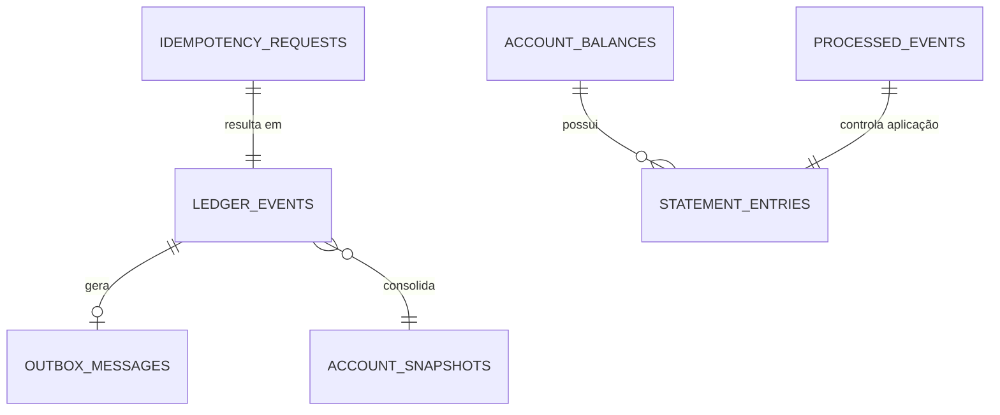

# Data model

## Separação física

Existem dois bancos PostgreSQL, com credenciais, migrations e ciclos de backup próprios:

| Banco | Escritor autorizado | Função |
|---|---|---|
| `ledger` | Ledger API e Ledger Worker/Outbox Publisher | Fonte da verdade, append-only |
| `ledger_read` | Ledger Worker/Projection Consumer | Projeções descartáveis e reconstruíveis |

A existência de dois bancos é uma decisão de **CQRS**, não apenas uma separação lógica. O PostgreSQL Ledger é otimizado para escrita consistente e o PostgreSQL Read para consultas. Como saldo e extrato normalmente recebem mais acessos que créditos e débitos, o banco de leitura pode ganhar capacidade independentemente do banco de escrita. No desafio ele terá uma única instância; WAL e réplicas ficam como evolução caso o SLA exija alta disponibilidade.

A escolha de PostgreSQL, em vez de EventStoreDB para o Ledger, está justificada no [ADR-005](../adrs/ADR-005-postgresql-em-vez-de-eventstoredb.md).

A Query API possui acesso somente leitura. Não há foreign key nem transação distribuída entre os dois bancos.

Valores monetários são armazenados somente em unidades mínimas (`BIGINT`). No MVP, a única moeda aceita é BRL e os valores representam centavos; nunca se usa `decimal`, `float` ou `double` na persistência.
Dados cadastrais e PII pertencem ao serviço de clientes/contas, fora desta fronteira. O Ledger guarda apenas o `account_id` opaco necessário à contabilização.

## Resumo das tabelas

| Banco | Tabela | Para que serve | Fonte da verdade? |
|---|---|---|---|
| Ledger | `ledger_events` | Guardar o histórico imutável de créditos e débitos | Sim |
| Ledger | `account_snapshots` | Acelerar a reconstrução do saldo sem ler todos os eventos | Não; pode ser recriada |
| Ledger | `idempotency_requests` | Impedir que o mesmo request gere duas movimentações | Controle transacional |
| Ledger | `outbox_messages` | Garantir que todo evento confirmado seja posteriormente publicado no Kafka | Controle transacional |
| Read | `account_balances` | Responder rapidamente o saldo atual | Não; pode ser reprojetada |
| Read | `statement_entries` | Responder rapidamente o extrato | Não; pode ser reprojetada |
| Read | `processed_events` | Impedir que um evento duplicado altere a projeção duas vezes | Controle técnico |

Não existe uma tabela `accounts` neste domínio porque cadastro, titularidade e dados pessoais pertencem ao serviço de contas/clientes. A existência da conta é validada por integração ou por uma referência previamente conhecida; o Ledger armazena somente seu identificador.

## PostgreSQL Ledger — fonte da verdade

### `ledger_events`

É a tabela principal e a **fonte da verdade**. Cada linha representa um fato financeiro já confirmado: crédito ou débito. A Ledger API insere os eventos; eles não são atualizados nem removidos.

Ao processar um novo débito, a aplicação recupera o snapshot mais recente e os eventos posteriores para reconstruir o saldo e validar a operação. Em caso de divergência com o Read Model, esta tabela prevalece.

| Coluna | Tipo | Regra |
|---|---|---|
| `event_id` | `UUID` | PK, gerado no servidor |
| `account_id` | `UUID` | Conta/agregado |
| `sequence` | `BIGINT` | Versão crescente por conta |
| `event_type` | `VARCHAR(80)` | `CreditPosted` ou `DebitPosted` no MVP |
| `event_version` | `SMALLINT` | Versão do schema do evento |
| `amount_minor` | `BIGINT` | Valor positivo em unidade mínima |
| `currency` | `CHAR(3)` | Fixo em `BRL` no MVP |
| `effective_at` | `TIMESTAMPTZ` | Quando produz efeito contábil |
| `recorded_at` | `TIMESTAMPTZ` | Quando foi persistido pelo servidor |
| `transaction_id` | `UUID` | Identifica a transação contábil |
| `causation_id` | `UUID NULL` | Evento/comando que causou este evento |
| `correlation_id` | `UUID` | Correlação ponta a ponta |
| `payload` | `JSONB` | Dados versionados específicos do evento |
| `metadata` | `JSONB` | Origem, ator e informações técnicas sem PII desnecessária |

Restrições e índices:

- PK em `event_id`;
- `UNIQUE (account_id, sequence)` para concorrência otimista;
- índice `(account_id, recorded_at, sequence)` para replay histórico;
- `CHECK (amount_minor > 0)`;
- `CHECK (currency = 'BRL')`;
- nenhuma operação de negócio recebe permissão de `UPDATE` ou `DELETE`.

Não existe a tabela `ledger_entries` no escopo atual. Cada crédito ou débito é representado diretamente por um evento. A justificativa e a evolução para partidas dobradas estão no [ADR-001](../adrs/ADR-001-ledger-simplificado.md).

### `account_snapshots`

Guarda uma fotografia do saldo após determinada `sequence`. Serve apenas para desempenho: em vez de reproduzir milhares de eventos, a Ledger API começa pelo snapshot mais recente e aplica somente os eventos posteriores.

A Ledger API gera um snapshot a cada 50 eventos confirmados por conta. Esse é o padrão adotado no desafio. Se a criação falhar, nenhum dado financeiro é perdido; a conta apenas será reconstruída lendo mais eventos.

| Coluna | Tipo | Regra |
|---|---|---|
| `account_id` | `UUID` | Parte da PK |
| `sequence` | `BIGINT` | Parte da PK e último evento incorporado |
| `balance_minor` | `BIGINT` | Saldo naquele ponto |
| `currency` | `CHAR(3)` | Fixo em `BRL` no MVP |
| `schema_version` | `SMALLINT` | Versão do snapshot |
| `checksum` | `VARCHAR(128)` | Verificação de integridade |
| `created_at` | `TIMESTAMPTZ` | Data de criação |
| `last_recorded_at` | `TIMESTAMPTZ` | `recorded_at` do último evento incorporado |

PK composta: `(account_id, sequence)`. Snapshot é otimização; pode ser descartado e recriado.

### `idempotency_requests`

Evita créditos ou débitos duplicados quando o cliente repete uma requisição por timeout. Antes de executar o comando, a Ledger API procura a combinação `client_id + idempotency_key`.

Se a chave já existir com o mesmo payload, a API devolve a resposta original. Se existir com outro payload, retorna conflito. Evento, idempotência e Outbox são confirmados na mesma transação.

| Coluna | Tipo | Regra |
|---|---|---|
| `client_id` | `VARCHAR(100)` | Identidade do chamador; parte da PK |
| `idempotency_key` | `VARCHAR(100)` | Parte da PK |
| `request_hash` | `VARCHAR(128)` | Detecta reutilização com payload diferente |
| `event_id` | `UUID` | Evento produzido |
| `response_status` | `SMALLINT` | Status HTTP original |
| `response_body` | `JSONB` | Resposta original |
| `created_at` | `TIMESTAMPTZ` | Auditoria e retenção |

PK composta: `(client_id, idempotency_key)`. É gravada na mesma transação do evento e do Outbox.

### `outbox_messages`

Resolve a falha entre gravar o evento no PostgreSQL e publicá-lo no Kafka. A Ledger API insere o evento e sua mensagem de Outbox na mesma transação; portanto, nunca existe evento confirmado sem uma publicação pendente correspondente.

O Outbox Publisher busca registros com `published_at IS NULL`, envia ao Kafka e marca a publicação. Como uma mensagem pode ser reenviada após uma falha, os consumidores precisam continuar idempotentes.

| Coluna | Tipo | Regra |
|---|---|---|
| `message_id` | `UUID` | PK; normalmente igual ao `event_id` |
| `topic` | `VARCHAR(150)` | Tópico de destino |
| `partition_key` | `UUID` | `account_id` |
| `aggregate_sequence` | `BIGINT NOT NULL` | Sequência do evento dentro da conta |
| `payload` | `JSONB` | Envelope completo do evento |
| `headers` | `JSONB` | Versão e correlação |
| `created_at` | `TIMESTAMPTZ` | Momento do commit |
| `published_at` | `TIMESTAMPTZ NULL` | Nulo enquanto pendente |
| `attempts` | `INTEGER` | Tentativas de publicação |
| `last_error` | `TEXT NULL` | Diagnóstico sem dado sensível |

Restrições e índices:

- `UNIQUE (partition_key, aggregate_sequence)` impede duas mensagens para a mesma sequência da conta;
- índice parcial `(partition_key, aggregate_sequence) WHERE published_at IS NULL` identifica a mensagem pendente mais antiga de cada conta;
- índice parcial `(created_at, message_id) WHERE published_at IS NULL` apoia a seleção global dos lotes.

O Publisher somente seleciona uma mensagem quando não existe `aggregate_sequence` anterior ainda pendente para o mesmo `partition_key`. Assim, duas réplicas podem publicar contas diferentes em paralelo sem inverter a ordem de uma mesma conta.

## PostgreSQL Read — projeções

Este banco não decide se um débito ou crédito é válido. Ele recebe somente eventos já confirmados e mantém formatos preparados para consulta. Se for perdido ou corrompido, pode ser reconstruído pelo replay do PostgreSQL Ledger.

### `account_balances`

Mantém uma única linha com o saldo atual de cada conta. O Projection Consumer do Ledger Worker atualiza essa linha ao consumir cada evento; a Query API a utiliza no endpoint `GET /v1/accounts/{accountId}/balance`.

`last_sequence` informa até qual evento o saldo foi calculado. Isso permite detectar mensagens fora de ordem e indicar se a projeção está atrasada.

| Coluna | Tipo | Regra |
|---|---|---|
| `account_id` | `UUID` | PK |
| `balance_minor` | `BIGINT` | Saldo atual projetado |
| `currency` | `CHAR(3)` | Fixo em `BRL` no MVP |
| `last_sequence` | `BIGINT` | Última sequência aplicada |
| `last_event_id` | `UUID` | Último evento aplicado |
| `updated_at` | `TIMESTAMPTZ` | Atualização da projeção |

### `statement_entries`

Mantém uma linha simplificada por movimentação para montar o extrato sem consultar ou reproduzir todo o Event Store. O Projection Consumer do Ledger Worker grava a linha e a Query API a consulta em `GET /v1/accounts/{accountId}/statement`.

`balance_after_minor` guarda o saldo após aquela movimentação e facilita a exibição do extrato. A tabela não é fonte da verdade e pode ser apagada e recriada usando `ledger_events`.

| Coluna | Tipo | Regra |
|---|---|---|
| `event_id` | `UUID` | PK |
| `account_id` | `UUID` | Conta consultada |
| `sequence` | `BIGINT` | Ordem estável na conta |
| `movement_type` | `VARCHAR(20)` | `CREDIT` ou `DEBIT` |
| `amount_minor` | `BIGINT` | Valor positivo |
| `balance_after_minor` | `BIGINT` | Saldo após aplicação na ordem registrada |
| `currency` | `CHAR(3)` | Fixo em `BRL` no MVP |
| `description` | `VARCHAR(255)` | Descrição sanitizada |
| `effective_at` | `TIMESTAMPTZ` | Data contábil |
| `recorded_at` | `TIMESTAMPTZ` | Data de registro |
| `transaction_id` | `UUID` | Correlação contábil |

Restrições/índices: `UNIQUE (account_id, sequence)` e índices para `(account_id, recorded_at DESC)` e `(account_id, effective_at DESC)`.

### `processed_events`

É a Inbox idempotente do Projection Consumer. Kafka oferece entrega pelo menos uma vez, então o mesmo evento pode chegar novamente depois de uma falha ou rebalanceamento.

Antes de alterar saldo e extrato, o Worker tenta inserir o `event_id`. Se ele já existir para aquela projeção, a mensagem é ignorada. A inserção e as atualizações do Read Model acontecem na mesma transação.

| Coluna | Tipo | Regra |
|---|---|---|
| `projection_name` | `VARCHAR(100)` | Parte da PK |
| `event_id` | `UUID` | Parte da PK; impede duplicidade |
| `account_id` | `UUID` | Diagnóstico e reconciliação |
| `sequence` | `BIGINT` | Validação de ordem |
| `processed_at` | `TIMESTAMPTZ` | Auditoria operacional |

PK composta: `(projection_name, event_id)`. A inserção nesta tabela e as alterações em saldo/extrato ocorrem na mesma transação.

## Relações principais

As relações acima são conceituais. Não existem foreign keys entre o banco Ledger e o banco Read.

## Como as tabelas trabalham juntas

### Crédito ou débito

1. A Ledger API consulta `idempotency_requests`.
2. Reconstrói o saldo usando `account_snapshots` mais a cauda de `ledger_events`.
3. Na mesma transação, insere em `ledger_events`, `idempotency_requests` e `outbox_messages`.
4. O Outbox Publisher envia a mensagem ao Kafka.
5. O Projection Consumer registra `processed_events` e atualiza `account_balances` e `statement_entries` na mesma transação do PostgreSQL Read.

### Consulta de saldo

1. A Query API consulta uma linha de `account_balances`.
2. O campo `last_sequence` informa o checkpoint da projeção.
3. Se for solicitada leitura forte, a API usa snapshot mais eventos do PostgreSQL Ledger.
4. Se `at` for informado, usa somente snapshots e eventos com `recorded_at <= at`.

O histórico do desafio usa `recorded_at`, respondendo qual saldo o sistema conhecia naquele instante. Uma visão bitemporal que reorganize movimentos por `effective_at` fica como evolução futura.

### Consulta de extrato

1. A Query API consulta `statement_entries` por `account_id`.
2. O índice por data e sequência permite paginação ordenada.
3. Nenhum replay é necessário durante a consulta normal.

## Reprojeção

Para reconstruir o Read Model:

1. cria-se um novo schema/banco de leitura;
2. reproduzem-se `ledger_events` por `account_id, sequence`;
3. valida-se saldo, quantidade e último checkpoint contra o Ledger;
4. troca-se a Query API para a nova projeção;
5. o banco antigo permanece disponível para rollback por período controlado.

Caso correções regulatórias sejam incorporadas futuramente, deverão usar novos eventos compensatórios e reprojeção, sem alterar eventos passados.
